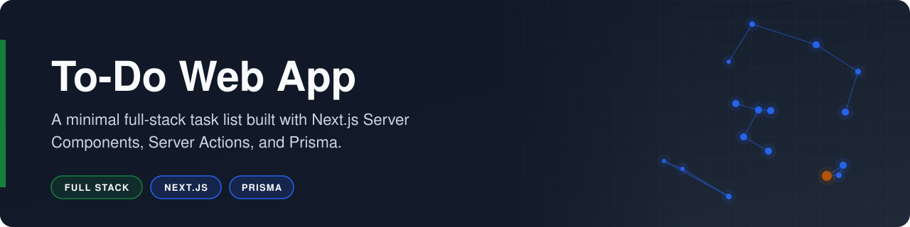
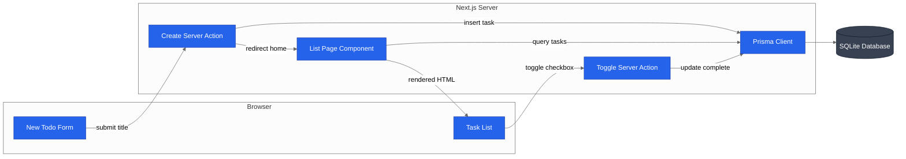

<p align="center"></p>

# To-Do Web App

**A minimal full-stack task list built with Next.js Server Components, Server Actions, and Prisma.**

    

To-Do Web App is a small learning project that implements a create, list, and complete task flow on the Next.js App Router. Pages read the database directly from Server Components, and every write goes through a Server Action, so the app has no REST endpoints and no client-side data fetching code.

## Overview

The project is complete and preserved as a reference implementation. The app stores tasks in a local SQLite database through Prisma. The home page lists every task with its saved completion state, and the New Todo page posts a title to a Server Action that validates it, inserts the row, and redirects back to the list.

- **Server-rendered list:** `src/app/page.tsx` is an async Server Component that queries all tasks with Prisma.
- **Server Action form:** `src/app/new/page.tsx` submits the form to an inline `createToDo` action with no API route.
- **Persisted completion:** checking a task calls the `toggleTodo` Server Action, which saves the `complete` field to the database.
- **Typed data layer:** `prisma/schema.prisma` defines the `Todo` model, and `src/db.ts` shares one Prisma client across reloads in development.

## Business Case

### The Problem

Modern React full-stack patterns, such as Server Components that read the database directly and Server Actions that replace API routes, are recent additions to the ecosystem. Clear, small reference implementations of these patterns are scarce, and most examples bury the data path inside larger applications.

### Who It Serves

- **Developers learning the App Router:** a compact example of the request path from form to database to page.
- **Reviewers of the author's work:** evidence of full-stack fundamentals across React, TypeScript, and a relational schema.
- **The author:** a starting template for future CRUD applications.

### The Outcome

The project delivers a working create, list, and complete flow with zero client-side data fetching code and zero REST endpoints. It shows the full path from user input to database write to re-rendered page across five small source files, and task completion survives reloads and restarts.

## How It Works

Form submissions and checkbox toggles run Server Actions that write to SQLite through Prisma, then the list page re-renders from the database on the server.



1. **Open the form:** the New Todo link on the home page navigates to `/new` (`src/app/new/page.tsx`).
2. **Submit:** the form posts its `title` field to the `createToDo` Server Action.
3. **Validate:** the action rejects a missing or empty title.
4. **Persist:** the action inserts a `Todo` row with `complete: false` through the shared client in `src/db.ts` and revalidates the list.
5. **Redirect:** the action redirects to `/`, where `src/app/page.tsx` loads every task with `prisma.todo.findMany()`.
6. **Render:** each task renders through `src/components/TodoItem.tsx` as a checkbox initialized from its stored `complete` value.
7. **Toggle:** checking or clearing a box calls the `toggleTodo` Server Action in `src/app/page.tsx`, which updates `complete` and revalidates the list.

## Tech Stack

| Layer | Technology | Purpose |
|---|---|---|
| Frontend | Next.js 15 (App Router) and React 19 | Server-rendered pages and Server Actions |
| Frontend | Tailwind CSS 3 | Utility-first styling |
| Backend | Next.js Server Actions | Form handling without API routes |
| Data | Prisma 6 | Schema, migrations, and typed queries |
| Data | SQLite | Local file-based database |
| Tooling | TypeScript 5 and ESLint 9 | Static typing and linting |

## Getting Started

### Prerequisites

- Node.js 18.18 or later.
- npm.

### Installation

1. Clone the repository.

   ```bash
   git clone https://github.com/risingOnIP/to-do-web-app.git
   cd to-do-web-app
   ```

2. Install the dependencies.

   ```bash
   npm install
   ```

3. Create the environment file.

   ```bash
   cp .env.example .env
   ```

4. Create the database and generate the Prisma client.

   ```bash
   npx prisma migrate dev
   ```

### Configuration

| Variable | Required | Description |
|---|---|---|
| `DATABASE_URL` | Yes | SQLite connection string, for example `file:./dev.db` (resolved relative to `prisma/`) |

### Usage

```bash
npm run dev
```

Open `http://localhost:3000` to see the task list. Select New Todo, enter a title, and select Create to add a task and return to the list. Check a task to mark it complete; the state is saved and remains after a reload.

## Project Structure

```text
to-do-web-app/
├── prisma/
│   ├── migrations/          # initial Todo table migration
│   └── schema.prisma        # Todo model and SQLite datasource
├── src/
│   ├── app/
│   │   ├── new/
│   │   │   └── page.tsx     # create form and Server Action
│   │   ├── globals.css      # Tailwind directives
│   │   ├── layout.tsx       # root layout, fonts, and metadata
│   │   └── page.tsx         # task list and toggle Server Action
│   ├── components/
│   │   └── TodoItem.tsx     # client checkbox and label for one task
│   └── db.ts                # shared Prisma client instance
├── .env.example             # sample database connection string
├── package.json
├── tailwind.config.ts
├── LICENSE
└── README.md
```

## Roadmap

- [ ] Add delete support for individual tasks.
- [ ] Add editing of task titles.
- [ ] Add inline validation feedback for empty titles.
- [ ] Order tasks by creation date.

## Acknowledgments

- Project scaffolding from [create-next-app](https://nextjs.org/docs/app/api-reference/cli/create-next-app).

## License

Released under the [MIT License](LICENSE).

## Author

Developed by [Karthik Kaligotla](https://github.com/risingOnIP), named inventor on U.S. Patents [12,445,488 B2](https://patents.google.com/patent/US12445488B2/) and [12,598,158 B2](https://patents.google.com/patent/US12598158B2/).
